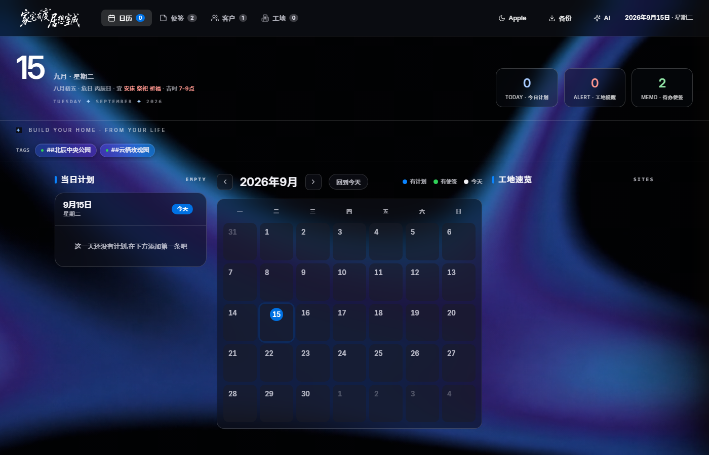
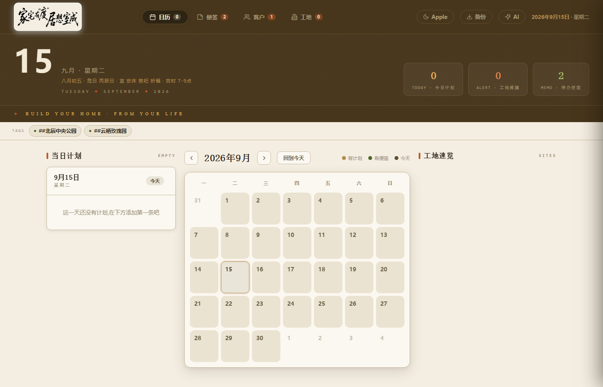
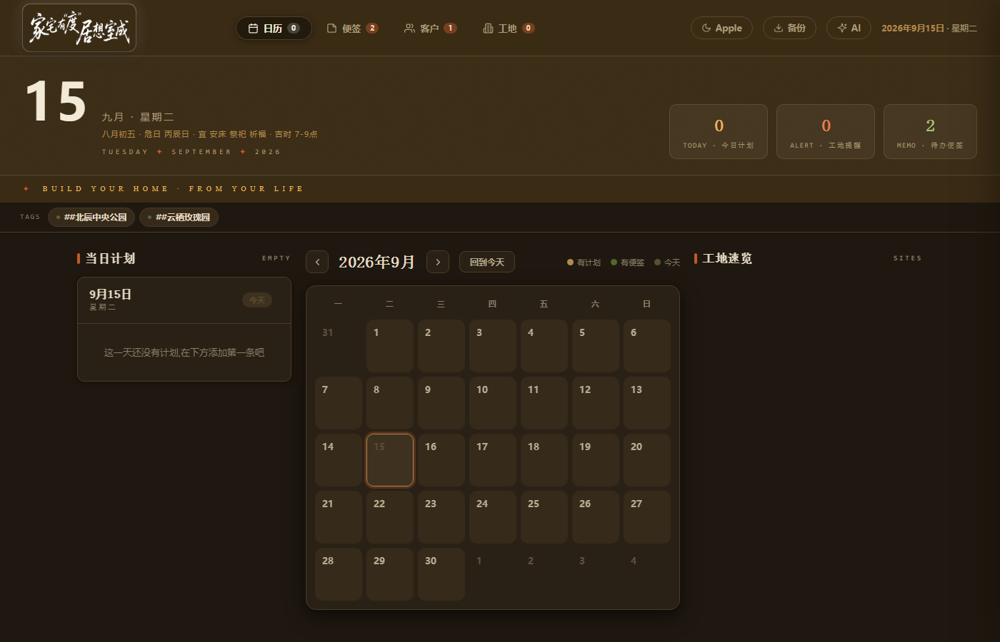
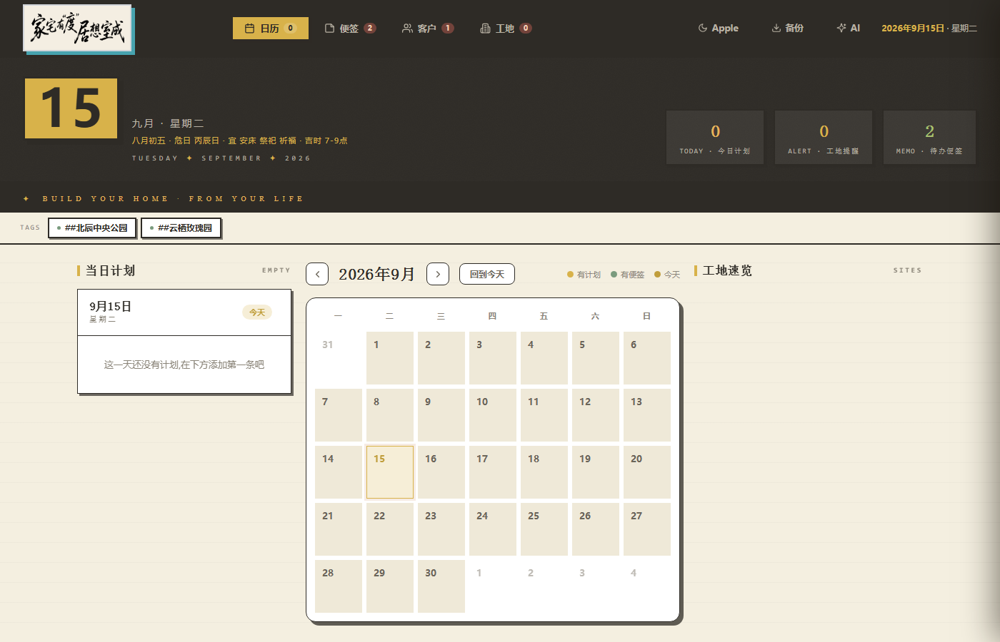
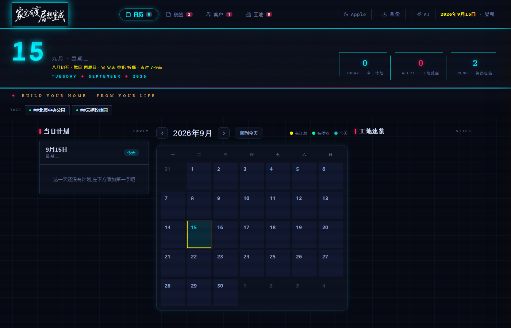

# LUSEM 个人工作站

> 日历 · 便签 · 客户 · 工地 — 室内设计师的一站式桌面工作台

单文件 HTML 应用，数据存浏览器 localStorage，零依赖、离线可用。

## 预览

### Apple · 玻璃白（默认主题）


### 浅色


### 深色


### 粗野主义


### 赛博朋克


## 功能

- **日历**：当日计划管理、工地提醒、跨阶段预警、农历黄历
- **便签**：瀑布流双列、多内容块、标签关联工地、AI 预判注意事项
- **客户**：楼盘/风格标签、跟进进度、关联便签与日历记录、一键转签约
- **工地**：施工/设计双体系、阶段进度追踪、全局标签
- **AI**：DeepSeek 驱动，便签预判冲突、计划识别标签
- **备份**：JSON 导入导出、自动备份、图片压缩
- **☁ 同步**：Chrome 扩展 + 坚果云 WebDAV，多设备数据同步

## 在线版

**推荐（国内直连可用，CDN）**

- 短链：https://cdn.jsdelivr.net/gh/lusem1212/XUANFENG@main/app.html
- 直链：https://cdn.jsdelivr.net/gh/lusem1212/XUANFENG@main/LUSEM%E7%9A%84%E4%B8%AA%E4%BA%BA%E5%B7%A5%E4%BD%9C%E7%AB%99.html

**GitHub Pages**（由本仓库 `main` 根目录发布，国内直连常被卡到打不开，仅作备份入口）

- https://lusem1212.github.io/XUANFENG/

> jsDelivr 对 `@main` 有缓存，仓库更新后可访问 https://purge.jsdelivr.net/gh/lusem1212/XUANFENG@main/app.html 立即刷新。

## 使用

直接双击 `LUSEM的个人工作站.html` 即可打开，无需安装任何依赖。

`video.mp4`（Apple 主题的动态背景，664KB）需与 HTML **放在同一目录**；缺失时页面自动退回 CSS 渐变 + 海报兜底，功能不受影响。

## 体积

主文件 **471KB**（CSS 169KB + JS 216KB + 图片 46KB）。背景视频已从 base64 内嵌改为独立 `video.mp4` 惰性加载——首屏 HTML 从 1.34MB 降到 471KB，手机加载快 3 倍。

## V4 · 数据服务版（本地服务 + bot 写入）

主文件已升级为 **V4（数据服务版）**：数据真源从浏览器 localStorage 挪到磁盘 `data/data.json`，
并暴露 HTTP 接口让 bot / 脚本直接写计划——「发条消息就自动进日历」已经跑通（bot 写入 → 页面 3.5 秒内出现）。

```bash
node server/ws-server.mjs          # 零依赖，绑 127.0.0.1:8787
# 浏览器打开 http://127.0.0.1:8787/
```

服务没起时页面自动降级回纯 localStorage，保存照常生效；`file://` 直接打开也能用。

| 接口 | 用途 |
|---|---|
| `GET /api/health` | 健康检查 |
| `GET /api/state` | 读全量 |
| `PUT /api/state` | 页面保存（rev 乐观锁，冲突返 409） |
| `GET /api/rev` | 只回版本号（页面 8 秒轮询） |
| `POST /api/plan` | bot 追加计划 |

详细说明见 `说明-V4数据服务版.md`。

> ⚠️ `data/` 里是真实数据，已在 `.gitignore` 中排除，不入库。

## 文件说明

| 路径 | 说明 |
|---|---|
| `LUSEM的个人工作站.html` | **主正本**：V4 数据服务版（单文件应用，471KB） |
| `video.mp4` | Apple 主题动态背景（惰性加载，缺失自动兜底） |
| `app.html` | **短链入口**：ASCII 文件名，跳转到主正本（好记好发） |
| `index.html` | Pages 入口，跳转到主正本 |
| `server/` | V4 本地数据服务（`ws-server.mjs` 主服务、`ws-mirror.mjs` 镜像、`ws-webdav.mjs` WebDAV 桥） |
| `tools/` | 数据迁移 / 坚果云配置脚本 |
| `原生版/` | Tauri 桌面 App 用的页面副本（含手机端适配：Hero 折叠、长按 ＋、刘海安全区） |
| `extensions/` | 坚果云同步 Chrome 扩展 |
| `previews/` | 五套主题预览截图 |
| `说明-V4数据服务版.md` | V4 接口与设计要点 |
| `使用说明.md` | 面向使用的完整说明 |
| `项目日志.md` | 逐版改动记录 |

## 多设备同步

工作站支持通过 Chrome 扩展 + 坚果云实现多设备数据同步（如办公电脑 ↔ 家里电脑）。

### 安装

1. 下载仓库的 `extensions/` 文件夹（或整个仓库）
2. Chrome 打开 `chrome://extensions/`，开启「开发者模式」
3. 点「加载已解压的扩展程序」，选择 `extensions/` 文件夹
4. Windows 用户可双击 `extensions/安装到Chrome.bat` 一键安装

### 配置

1. 先在 [坚果云](https://www.jianguoyun.com) 获取**应用密码**：
   - 登录 → 右上角头像 → 账户信息 → 安全选项
   - 「第三方应用授权」→ 添加应用 → 输入「工作站同步」→ 复制密码
2. 点浏览器右上角扩展图标 → ⚙ 设置
3. 填入坚果云账号 + 应用密码 + 设备名称（如「办公电脑」）
4. 点「测试连接」确认成功，保存

### 使用

- **手动同步**：点扩展图标 → 「同步」按钮
- **自动同步**：设置中开启「自动同步」，可选间隔（1~30 分钟）
- **推送到云端**：仅上传本地数据
- **从云端拉取**：仅下载云端数据覆盖本地

### 工作原理

```
扩展通过 chrome.scripting 注入页面脚本到 MAIN world
直接读写页面的 localStorage（便签/计划/工地/客户数据）
通过坚果云 WebDAV API 双向同步备份 JSON 文件
```

- 数据源：浏览器 localStorage（`workstation-*` 前缀的 key）
- 同步协议：WebDAV（Basic Auth + 应用密码）
- 云端路径：`坚果云/WebDAV/LUSEM工作站备份/workstation-backup.json`
- 冲突策略：后同步者赢（时间戳对比）

## 技术

- 纯 HTML + CSS + JavaScript，单文件 471KB（背景视频已外置为 `video.mp4`）
- CSS 变量驱动的 5 套主题，一键切换
- localStorage 持久化，数据仅存本地
- Chrome Extension Manifest V3 + WebDAV 同步

---

*Design by LUSEM · Built with Hermes Agent*
